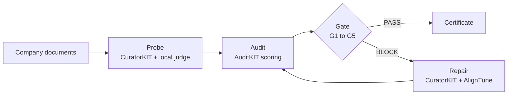

# HUMBLE

**A release check for fine-tuned RAG models: it catches a model that makes up answers when its documents don't have
them, blocks it, and repairs it.**

Track 1 (Fine-tuning and Data Curation), Lexsi AI Safety and Alignment Hackathon.
Built on Lexsi's **CuratorKIT**, **AlignTune** and **AuditKIT**, and on open **Cohere Labs** models. Everything runs
locally on one GPU, with no API calls.

[Live demo](https://huggingface.co/spaces/KM2007/humble-explorer) ·
[Write-up](docs/WRITEUP.md) ·
[Repaired model](https://huggingface.co/KM2007/humble-tinyaya-repaired-A) ·
[Data and every prediction](https://huggingface.co/datasets/KM2007/humble-v3-probes-and-audits) ·
[ROI](docs/ROI.md)

<p align="center"></p>

## The problem

Companies fine-tune a model on their own question-answer data and put it behind a search over their documents (RAG).
Search often brings back passages that don't contain the answer. A good model should then say so.

We found that ordinary fine-tuning removes that habit. On **four out of four** Cohere models, a standard fine-tune
made the model answer **100%** of questions its passages could not answer. At the same time accuracy went **up**
(for example 52.7% → 73.7% on Tiny Aya Global), so a normal accuracy check would approve the model for release.

## What HUMBLE does

1. **Probe.** Builds test questions from your own documents, including five kinds of question the documents cannot
   answer (missing fact, unknown entity, false premise, ambiguous question, misleading passage).
2. **Audit.** Runs the original and the fine-tuned model on them and measures accuracy, how often each one makes up an
   answer, and how often it refuses a question it should answer.
3. **Gate.** Compares the two with proper statistics and returns PASS or BLOCK (exit code 0 or 1), so it can sit in
   a release pipeline like any other test.
4. **Repair.** If blocked, builds a small training set from the model's own mistakes and retrains the adapter. About
   15 minutes on one GPU.
5. **Certify.** Writes a certificate with data hashes, the locked test fingerprint and confidence intervals, so the
   decision can be checked later.

## Results (locked test, evaluated once per model)

"Bluff rate" is the share of unanswerable questions the model answered anyway.

| Model | Original model: accuracy / bluff | Normal fine-tune: accuracy / bluff | After HUMBLE repair: accuracy / bluff / needless refusals |
|---|---|---|---|
| Tiny Aya Global | 52.7 / 59.8 | 73.3 / **100.0** → BLOCK | **72.3 / 27.3 / 1.7** → PASS on 3 of 3 seeds |
| Aya Expanse 8B | 84.7 / 89.5 | 90.0 / **100.0** → BLOCK | **90.4 / 17.2 / 0.4** → PASS on 3 of 3 seeds |
| Tiny Aya Fire | 60.0 / 64.0 | 72.3 / **100.0** → BLOCK | **71.1 / 25.8 / 2.2** → PASS on 3 of 3 seeds |
| Tiny Aya Earth | 55.7 / 78.0 | 73.6 / **100.0** → BLOCK | **71.9 / 26.6 / 1.8** → PASS on 3 of 3 seeds |

<p align="center"></p>

In short: the repair keeps the accuracy gained from fine-tuning (within 1–2 points), makes the model bluff far less
than even the original model did, and keeps needless refusals at 0.4–2.2%. The repaired Tiny Aya also refuses more
often on Spanish, Hindi and Arabic questions and on legal contracts, which it was never trained on.

<details>
<summary><b>All findings, including what did not work</b></summary>

* **The gate caught every bad fine-tune** on all four models and all seeds, and its self-checks behave as designed
  (the original model against itself passes; an always-refuse model and an always-answer model are blocked).
* **What keeps the repaired model from over-refusing:** mixing in normal training data 1:1. Without it, repair was
  blocked on every seed for refusing too much (about 17% needless refusals). Pairing each "I can't answer"
  example with an answerable twin helps a bit more.
* **Random repair data worked as well as targeted data.** Building the repair set from the model's own mistakes did
  not beat a random sample of the same size on cost (pre-registered hypothesis H3 not supported). The format of the
  repair data matters more than which mistakes it came from. On Tiny Aya Earth, though, both alternatives refused too often: the random
  version was blocked on the test set for one seed of three and a fresh honest fine-tune for all three, while the
  HUMBLE repair passed every seed.
* **Other fixes we tried:** training an honest model from scratch was blocked on the test set for over-refusing on
  Tiny Aya Global and Earth; adding a preference-training step (DPO) after repair added refusals and was blocked;
  scaling down the fine-tune's weights could not remove the bluffing without removing the fine-tune.
* **Model confidence does not reveal the bluffing**, so the gate looks at behaviour on unanswerable questions.
* **Upweighting the weakest question types** raised their refusal rate (72.6% → 77.3%), but the gain was significant
  on two of three seeds only.

Full tables with confidence intervals: [results/v3/RESULTS.md](results/v3/RESULTS.md) and one file per model in
[results/v3/](results/v3/).
</details>

## How we used Lexsi's toolkits and Cohere's models

| Tool or model | What we used it for | How much it did for us |
|---|---|---|
| **CuratorKIT** | Checks every training set before training: schema check, exact duplicate removal, a provenance record. Its QA generator and hallucination gate build test questions from a company's documents (`humble probe`), with a local model plugged in. | Every SFT and DPO training set in the project went through it, so every adapter can be traced to the exact data it saw. |
| **AlignTune** | All LoRA training (SFT through its TRL backend), the preference-training (DPO) arm, and model merging for the weight-scaling arm. | About 70 training runs across four models with one training function. It also exposed a real bug in our setup: its DPO step rebuilt the model and silently dropped our adapter; we caught it from the adapter weights and fixed the wrapper. |
| **AuditKIT** | Scores every model answer (normalised F1, abstain, format), fingerprints each run, and gives a paired significance test that we use to cross-check our own statistics. | Every audit carries an AuditKIT run record; 113 of them are in the public dataset alone. Any gate decision can be recomputed from them on a laptop. |
| **Tiny Aya Global** (3.35B) | The main model: small enough for one GPU, multilingual, the kind a company would fine-tune and host itself. | All experiments and ablations. Its multilingual training let us test transfer to Spanish, Hindi and Arabic. |
| **Aya Expanse 8B** | The local judge (checks that a test question really can or cannot be answered from its passages, and re-grades long answers), and a fourth model for the main recipe. | Let us keep everything local, with no API, and show the recipe works on a larger model that answers in full sentences. |
| **Tiny Aya Fire and Earth** | The same recipe, unchanged, on two more Cohere models. | Showed the result is not tied to one checkpoint. |

## Features

* Test questions built from your own documents, in five unanswerable categories plus answerable ones
* A local judge that verifies every test question; no data leaves your machine
* Locked test set: hashed, evaluated once per model, with a marker that stops a second run
* Metrics that cannot be gamed by refusing everything: accuracy, bluff rate and needless refusals together, with
  bootstrap confidence intervals by document
* Release gate with five rules (G1–G5) and four risk profiles (healthcare, finance, legal, support); exit codes for CI
* One-command repair loop that continues your existing LoRA adapter
* Certificates with data hashes and run fingerprints for an audit trail
* Transfer tests on other languages (XQuAD) and another domain (legal contracts, CUAD)
* Works across model sizes and answer styles; tested on four Cohere models
* Resumable jobs that can run in parallel across several GPUs

## Planned next

These are not built yet.

* Human labels for the judge check (100 items are prepared in `data/judge/`)
* Upweighting of the weakest question types as a standard option (it works on two of three seeds today)
* A ready-made CI action that runs the gate on every new fine-tune
* Faster serving (vLLM) for large probe sets
* Larger models (Aya Expanse 32B) and multi-turn, agent-style RAG

## Use it on your own model

```bash
pip install "humble[gpu] @ git+https://github.com/mudgalKrishna/HUMBLE"

humble probe  --docs ./company_docs --out ./probes
humble audit  --probes ./probes --out ./audits/original
humble audit  --probes ./probes --adapter ./my_finetune --original-audit ./audits/original --out ./audits/my_finetune
humble gate   ./audits/original ./audits/my_finetune --profile finance        # exit 0 = PASS, 1 = BLOCK
humble repair --blocked ./my_finetune --probes ./probes --original-audit ./audits/original --out ./adapters/repaired
```

`gate`, `selfcheck` and `certify` run on CPU; the other commands need a GPU.

## Reproduce our result on a laptop

No GPU and no token needed; about two minutes.

```bash
pip install huggingface_hub pyyaml
python scripts/reproduce.py
```

It downloads the saved locked-test predictions, re-runs the gate (the normal fine-tune is blocked, the repaired model
passes) and regenerates [results/v3/RESULTS.md](results/v3/RESULTS.md) from the public data.

<details>
<summary><b>How it works in more detail</b></summary>



* **Test questions**: each has four passages. Answerable ones hide the right passage among others from the same
  article. Unanswerable ones remove the answer, swap in an unknown entity, use a false premise, make the question
  ambiguous, or edit the passage to state a wrong answer. Each is checked by rule and by the judge.
* **Gate rules**: G1 bluffing went up, G2 needless refusals went up, G3 accuracy went down, G4 one question type got
  much worse, G5 too many badly formatted answers. Each rule uses a paired confidence interval against the original.
* **Repair**: find the questions the model bluffs on (five samples each), train it to refuse those, train it to answer
  their answerable twins, add verified variants, mix in normal training data 1:1, retrain one epoch, check again.
  Up to three rounds; one was enough every time.
</details>

## Repository

| Path | What is in it |
|---|---|
| `src/humble/` | the package: probes, audit, gate, repair, judge, curation, training, certificates, experiment jobs |
| `configs/default.yaml` | models, paths, risk profiles, gate thresholds, training settings |
| `tests/` | tests for parsing, metrics, gate rules, probe building and repair building |
| `results/v3/` | results for every model, the report generator, and raw run archives |
| `data/` | the locked test questions shared by every run, and the judge label sheet |
| `docs/` | write-up, abstract, ROI, HF article text, and the pre-registered project plan |
| `scripts/` | `reproduce.py`, plus the scripts used for the parallel notebook runs |

## Team and licences

Krishna, Tasmayu and Mohit.

Adapters inherit CC BY-NC 4.0 and the Cohere Labs Acceptable Use Policy from the base models (non-commercial).
Test data built from SQuAD 2.0 and XQuAD is CC BY-SA 4.0; CUAD is CC BY 4.0. AlignTune is MIT; CuratorKIT and
AuditKIT are source-available (LSAL).
