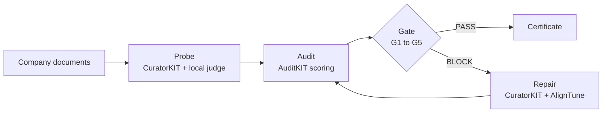

<p align="center"></p>

<h3 align="center">Your fine-tuned model just passed every eval.<br>It also makes up an answer every single time your documents don't have one.<br>HUMBLE catches it before you ship, and fixes it in 15 minutes.</h3>

<p align="center">
<a href="https://huggingface.co/spaces/KM2007/humble-explorer"><b>Live demo</b></a> ·
<a href="docs/WRITEUP.md">Write-up</a> ·
<a href="https://huggingface.co/KM2007/humble-tinyaya-repaired-A">Repaired model</a> ·
<a href="https://huggingface.co/datasets/KM2007/humble-v3-probes-and-audits">Every prediction</a> ·
<a href="docs/ROI.md">ROI</a>
</p>

<p align="center">Track 1 · Lexsi AI Safety and Alignment Hackathon · built on Lexsi <b>CuratorKIT</b>, <b>AlignTune</b>, <b>AuditKIT</b> and open <b>Cohere Labs</b> models · runs on one GPU, no API</p>

<p align="center"></p>

## The failure nobody is measuring

Every company building an assistant on its own documents does the same two things: retrieve passages, and fine-tune
the model on its own Q&A data. Retrieval misses all the time. When it does, the model should say "I can't answer that
from these documents."

**Fine-tuning quietly deletes that instinct.** We fine-tuned four Cohere models the standard way. All four went from
sometimes saying "I don't know" to answering **100%** of the questions their documents could not answer, with made-up
answers, on every seed. And accuracy went **up** by up to 21 points, so every normal eval says the model got better
and ships it.

That is the model that ends up in front of customers in support, legal, finance and health: confidently wrong, and
graded as an improvement.

**HUMBLE is the release check for exactly this failure, plus the fix.**

| | Normal fine-tune | After HUMBLE |
|---|---|---|
| Answers questions its documents can't support | **100%** on 4 of 4 models | **17–27%**, less than the original model |
| Accuracy gained from fine-tuning | kept | kept (within 1–2 points) |
| Refuses questions it should answer | 0% | 0.4–2.2% |
| Release decision | BLOCK, every seed | PASS, every seed |
| Cost | | about 15 minutes on one GPU, fully local |

## What HUMBLE does

1. **Probe.** Builds test questions from your own documents, including five kinds of question the documents cannot
   answer (missing fact, unknown entity, false premise, ambiguous question, misleading passage).
2. **Audit.** Runs the original and the fine-tuned model on them and measures accuracy, how often each one makes up an
   answer, and how often it refuses a question it should answer.
3. **Gate.** Compares the two with proper statistics and returns PASS or BLOCK (exit code 0 or 1), so it can sit in
   a release pipeline like any other test.
4. **Repair.** If blocked, builds a small training set from the model's own mistakes and retrains the adapter. About
   15 minutes on one GPU.
5. **Certify.** Writes a certificate with data hashes, the locked test fingerprint and confidence intervals, so the
   decision can be checked later.

## Results (locked test, evaluated once per model)

"Bluff rate" is the share of unanswerable questions the model answered anyway.

| Model | Original model: accuracy / bluff | Normal fine-tune: accuracy / bluff | After HUMBLE repair: accuracy / bluff / needless refusals |
|---|---|---|---|
| Tiny Aya Global | 52.7 / 59.8 | 73.3 / **100.0** → BLOCK | **72.3 / 27.3 / 1.7** → PASS on 3 of 3 seeds |
| Aya Expanse 8B | 84.7 / 89.5 | 90.0 / **100.0** → BLOCK | **90.4 / 17.2 / 0.4** → PASS on 3 of 3 seeds |
| Tiny Aya Fire | 60.0 / 64.0 | 72.3 / **100.0** → BLOCK | **71.1 / 25.8 / 2.2** → PASS on 3 of 3 seeds |
| Tiny Aya Earth | 55.7 / 78.0 | 73.6 / **100.0** → BLOCK | **71.9 / 26.6 / 1.8** → PASS on 3 of 3 seeds |

<p align="center"></p>

In short: the repair keeps the accuracy gained from fine-tuning (within 1–2 points), makes the model bluff far less
than even the original model did, and keeps needless refusals at 0.4–2.2%. The repaired Tiny Aya also refuses more
often on Spanish, Hindi and Arabic questions and on legal contracts, which it was never trained on.

## Detailed findings (locked test; the arm-by-arm table is Tiny Aya Global)

| Model | Accuracy | Prudence (abstains on unanswerable) | Gate |
|---|---|---|---|
| Original Tiny Aya | 52.7% | 40.2% | reference |
| Naive fine-tune (3 seeds) | ~73% | **0.0%** | **BLOCK** (G1 bluffing, G4 every category) |
| HUMBLE repair loop, from the blocked model (A) | 72.3% | 72.7% | **PASS** after 1 round, every seed (val and test) |
| Random-data repair, same size (B) | 70.8% | 79.6% | PASS, every seed |
| Prevention: fresh honest fine-tune (C, 3 seeds) | 70.4% | 80.0% | PASS on val, **BLOCK on test** (G2: over-refusal 3.8–5.1%) |
| Training-free lambda scaling (D) | – | – | only lambda = 0 (the original) passes |

1. **Fine-tuning made the model bluff on every unanswerable question**, in all three seeds and all five
   unanswerable categories, while accuracy rose by 20 points. P(True) confidence did not reveal it (H2).
2. **The gate caught it** with label-based rules (no reliance on model confidence), and its self-controls behave
   as designed across four domain profiles.
3. **Repair rescues the broken fine-tune in one round**: bluffing falls from 100% to about 28%, the accuracy
   gain is kept, over-conservativeness stays near 1%. The repair transfers to Spanish/Hindi/Arabic (XQuAD) and to
   legal contracts (CUAD) without training on them.
4. **What protects against over-refusal (ablations, 3 seeds each).** Without replay of ordinary training data,
   repair over-refuses: blocked on G2 in every seed, test over-conservativeness about 18% and accuracy 58%. Without
   the answerable twins, all seeds pass on val but 2 of 3 are blocked on the locked test (over-conservativeness
   3.6% vs 1.7% with twins). Replay is the main protection; twins add a smaller one.
5. **Honest negative results.** Repair data built from the model's own mistakes did *not* beat a random
   sample of the same size (H3 not supported): targeted data keeps ~2 points more accuracy, random data abstains
   more. This also held when repairing an only partly broken model, whose mistakes are a real subset
   ([results/v3/FIX1_TARGETING.md](results/v3/FIX1_TARGETING.md)). A had lower over-refusal than prevention on every seed but significantly so on only one (H4 not supported
   under the pre-registered rule), although C is the one blocked on test. Adding two-way DPO after repair
   raised prudence by 3 points but was blocked on test for over-refusal (3.2%). Lambda scaling cannot keep any of
   the fine-tune: bluffing appears already at lambda = 0.05.

6. **The recipe transfers to a larger model (Aya Expanse 8B, unchanged recipe).** Naive fine-tuning again
   removed all abstention (prudence 10.5% → 0.0%) and was blocked; HUMBLE repair passed on every seed with
   accuracy 90.4% (naive 90.0%, original 84.7%), prudence 82.8% and over-refusal 0.4%; random data again abstained
   more (88.0%). Aya answers in full sentences, so accuracy and over-refusal there are judge-graded
   ([results/v3/RESULTS_aya-expanse-8b.md](results/v3/RESULTS_aya-expanse-8b.md)).

7. **And to two more Tiny Aya models (Fire and Earth).** On Tiny Aya Fire (teammate run) naive fine-tuning was
   blocked (prudence 36.0% → 0.0%) and HUMBLE repair passed on every seed (accuracy 71.1%, prudence 74.2%,
   over-refusal 2.2%); the random control B again abstained more (81.5%) and beat A on all three seeds, so H3 is
   not supported on Fire either; prevention (C) was not run
   ([results/v3/RESULTS_tiny-aya-fire.md](results/v3/RESULTS_tiny-aya-fire.md)). On Tiny Aya Earth
   all three naive seeds were blocked (prudence 22.0% → 0.0%) and A passed on every seed, val and locked-test
   certificates alike (accuracy 71.9%, prudence 73.4%, over-refusal 1.8%). Random data (B, 79.6% prudence) and
   prevention (C, 81.5%) abstained more but over-refused: B was blocked on the test set for one seed of three and C
   for all three (G2), so on Earth only the HUMBLE repair passed every seed
   ([results/v3/RESULTS_tiny-aya-earth.md](results/v3/RESULTS_tiny-aya-earth.md)).

8. **Upweighting the weak categories helps, but is seed-sensitive (Fix 2, Tiny Aya Global, teammate run).**
   Repeating the U3/U4/U5 repair examples (Acat) raised prudence on squad3v from 72.6% to 77.3% and on a new
   U4/U5 test set (squad3u45, 300 items from paragraphs no earlier prompt showed) from 33.9% to 42.2%, with about
   the same accuracy and about 0.8 points more unnecessary abstention. The gain is significant on seeds 31 and 33
   but not 32: consistent, but not a pass under the every-seed rule. Caveats: the blocked model is a retrain
   (`naive_s31b`), and squad3u45 does not exclude paragraphs from earlier iterations
   ([results/v3/FIX2_CATEGORIES.md](results/v3/FIX2_CATEGORIES.md),
   [results/v3/RESULTS_fix2_categories.md](results/v3/RESULTS_fix2_categories.md)).

Full tables with CIs: [results/v3/RESULTS.md](results/v3/RESULTS.md). Every number is regenerated from saved
`predictions.jsonl` files by `results/v3/make_report.py`.


## How we used Lexsi's toolkits and Cohere's models

| Tool or model | What we used it for | How much it did for us |
|---|---|---|
| **CuratorKIT** | Checks every training set before training: schema check, exact duplicate removal, a provenance record. Its QA generator and hallucination gate build test questions from a company's documents (`humble probe`), with a local model plugged in. | Every SFT and DPO training set in the project went through it, so every adapter can be traced to the exact data it saw. |
| **AlignTune** | All LoRA training (SFT through its TRL backend), the preference-training (DPO) arm, and model merging for the weight-scaling arm. | About 70 training runs across four models with one training function. It also exposed a real bug in our setup: its DPO step rebuilt the model and silently dropped our adapter; we caught it from the adapter weights and fixed the wrapper. |
| **AuditKIT** | Scores every model answer (normalised F1, abstain, format), fingerprints each run, and gives a paired significance test that we use to cross-check our own statistics. | Every audit carries an AuditKIT run record; 113 of them are in the public dataset alone. Any gate decision can be recomputed from them on a laptop. |
| **Tiny Aya Global** (3.35B) | The main model: small enough for one GPU, multilingual, the kind a company would fine-tune and host itself. | All experiments and ablations. Its multilingual training let us test transfer to Spanish, Hindi and Arabic. |
| **Aya Expanse 8B** | The local judge (checks that a test question really can or cannot be answered from its passages, and re-grades long answers), and a fourth model for the main recipe. | Let us keep everything local, with no API, and show the recipe works on a larger model that answers in full sentences. |
| **Tiny Aya Fire and Earth** | The same recipe, unchanged, on two more Cohere models. | Showed the result is not tied to one checkpoint. |

## Features

* Test questions built from your own documents, in five unanswerable categories plus answerable ones
* A local judge that verifies every test question; no data leaves your machine
* Locked test set: hashed, evaluated once per model, with a marker that stops a second run
* Metrics that cannot be gamed by refusing everything: accuracy, bluff rate and needless refusals together, with
  bootstrap confidence intervals by document
* Release gate with five rules (G1–G5) and four risk profiles (healthcare, finance, legal, support); exit codes for CI
* One-command repair loop that continues your existing LoRA adapter
* Certificates with data hashes and run fingerprints for an audit trail
* Transfer tests on other languages (XQuAD) and another domain (legal contracts, CUAD)
* Works across model sizes and answer styles; tested on four Cohere models
* Resumable jobs that can run in parallel across several GPUs

## Planned next

These are not built yet.

* Human labels for the judge check (100 items are prepared in `data/judge/`)
* Upweighting of the weakest question types as a standard option (it works on two of three seeds today)
* A ready-made CI action that runs the gate on every new fine-tune
* Faster serving (vLLM) for large probe sets
* Larger models (Aya Expanse 32B) and multi-turn, agent-style RAG

## Use it on your own model

```bash
pip install "humble[gpu] @ git+https://github.com/mudgalKrishna/HUMBLE"

humble probe  --docs ./company_docs --out ./probes
humble audit  --probes ./probes --out ./audits/original
humble audit  --probes ./probes --adapter ./my_finetune --original-audit ./audits/original --out ./audits/my_finetune
humble gate   ./audits/original ./audits/my_finetune --profile finance        # exit 0 = PASS, 1 = BLOCK
humble repair --blocked ./my_finetune --probes ./probes --original-audit ./audits/original --out ./adapters/repaired
humble certify ./audits/my_finetune --gate ./audits/my_finetune/gate.json --out ./certificates
```

`gate`, `selfcheck` and `certify` run on CPU; the other commands need a GPU.

## Reproduce our result on a laptop

No GPU and no token needed; about two minutes.

```bash
pip install huggingface_hub pyyaml
python scripts/reproduce.py
```

It downloads the saved locked-test predictions, re-runs the gate (the normal fine-tune is blocked, the repaired model
passes) and regenerates [results/v3/RESULTS.md](results/v3/RESULTS.md) from the public data.

<details>
<summary><b>How it works in more detail</b></summary>



* **Test questions**: each has four passages. Answerable ones hide the right passage among others from the same
  article. Unanswerable ones remove the answer, swap in an unknown entity, use a false premise, make the question
  ambiguous, or edit the passage to state a wrong answer. Each is checked by rule and by the judge.
* **Gate rules**: G1 bluffing went up, G2 needless refusals went up, G3 accuracy went down, G4 one question type got
  much worse, G5 too many badly formatted answers. Each rule uses a paired confidence interval against the original.
* **Repair**: find the questions the model bluffs on (five samples each), train it to refuse those, train it to answer
  their answerable twins, add verified variants, mix in normal training data 1:1, retrain one epoch, check again.
  Up to three rounds; one was enough every time.

Technical detail:

* **Probes** (RAG-style, 4 passages each): C1 gold + distractors (answer), C2 distractors only, C3 answer sentence
  deleted, C4 misleading edit of the gold passage (abstain); unanswerable categories U1 missing fact, U2 out of
  database, U3 false premise, U4 underspecified, U5 misleading evidence. Mechanically verified, then checked by a
  local sufficient-context judge (Aya Expanse 8B). Split by document; the test set is hash-locked and evaluated once.
* **Audit**: greedy answers in `ANSWER: <text>` / `ABSTAIN` format, scored by AuditKIT (SQuAD-style F1), honesty
  metrics from Alignment for Honesty (prudence, over-conservativeness, honesty score), cost score with
  domain-profile weights, document-clustered bootstrap CIs, per category / context / language.
* **Gate v2**: G1 bluffing (paired CI), G2 over-refusal, G3 accuracy, G4 per-category prudence, G5 format, with
  thresholds from domain profiles (healthcare, finance, legal, support). Exit codes 0 / 1 / 2.
* **Repair loop**: multisample diagnosis of the blocked model on a separate probe pool; repair set = each bluff →
  ABSTAIN, its answerable twin → gold, delete-a-fact and misleading variants → ABSTAIN, RAFT's no-gold case flipped to
  ABSTAIN, over-refusals → gold, 1:1 replay; curated by CuratorKIT; continue the blocked LoRA adapter with AlignTune
  SFT; re-gate on val; up to 3 rounds.
</details>

## Repository

| Path | What is in it |
|---|---|
| `src/humble/` | the package: probes, audit, gate, repair, judge, curation, training, certificates, experiment jobs |
| `configs/default.yaml` | models, paths, risk profiles, gate thresholds, training settings |
| `tests/` | tests for parsing, metrics, gate rules, probe building and repair building |
| `results/v3/` | results for every model, the report generator, and raw run archives |
| `data/` | the locked test questions shared by every run, and the judge label sheet |
| `docs/` | write-up, abstract, ROI, HF article text, and the pre-registered project plan |
| `scripts/` | `reproduce.py`, plus the scripts used for the parallel notebook runs |

## Reproducibility

Each audit folder stores `audit.toml` (model, adapter hash, probe hash, test lock, config hash, versions),
`predictions.jsonl`, `metrics.json`, the AuditKIT run, and gate files; any gate can be recomputed on CPU.

## Team and licences

Krishna, Tasmayu and Mohit.

Adapters inherit CC BY-NC 4.0 and the Cohere Labs Acceptable Use Policy from the base models (non-commercial).
Test data built from SQuAD 2.0 and XQuAD is CC BY-SA 4.0; CUAD is CC BY 4.0. AlignTune is MIT; CuratorKIT and
AuditKIT are source-available (LSAL).
